<div align="center">

# 🗺️ GMaps Lead CRM (`gmaps-lead-crm`)

**End-to-End B2B Lead Generation, Async Email Enrichment, Multi-Role Sales CRM & Paymob Checkout Platform**

[](https://www.python.org/)
[](https://www.djangoproject.com/)
[](https://tailwindcss.com/)
[](https://getbootstrap.com/)
[](https://www.selenium.dev/)
[](docs/PAYMOB_SETUP.md)
[](LICENSE)

</div>

---

**GMaps Lead CRM** is a full-stack lead intelligence and revenue operations platform built with Django. It automates the entire sales lifecycle—from **scraping Google Maps businesses** and **hunting corporate emails asynchronously**, to **distributing leads across tiered sales teams**, **approving deals with multi-level commission tracking**, and **collecting online payments via Paymob**.

---

## ✨ Key Capabilities

### 🔍 Automated Lead Extraction & Async Enrichment
- **Stealth Google Maps Scraper (`scrape_gmaps`)**: Headless Chrome automation with `selenium-stealth`, User-Agent rotation, smart waits, `gmaps_id` deduplication, and finite or infinite scroll modes.
- **Live Scraper Control Center**: Launch, monitor, and stop scraping or enrichment jobs directly from the web UI with real-time progress metrics and a terminal-style persistent console (`ScraperLog`).
- **Async Email Hunter (`enrich_leads`)**: High-concurrency `aiohttp` + `BeautifulSoup4` crawler that extracts business emails and `mailto:` links across scraped websites.
- **Excel / CSV Import & VCF Export**: Interactive column-mapping importer (`pandas` + `openpyxl`), custom dataset visibility/labels, and one-click `.vcf` contact export.

### 👥 Multi-Role Sales CRM & Team Commissions
- **Role-Based Access Control (RBAC)**: Distinct workflows for **Admins**, **Team Leads (Managers)**, and **Sales Agents**.
- **Lead Pipeline & Activity Tracking**: Status pipeline (`NOT_CONTACTED` → `SENT` → `FOLLOW_UP` → `DEAL` / `NO_DEAL`), immutable `LeadComment` history, scheduled follow-ups, and automated `ActivityTrackingMiddleware` online/away status.
- **Deal Approval Workflow**: Non-staff agents closing a deal trigger a `DealRequest` for admin confirmation with real-time notifications (`notifications` app).
- **Tiered Commissions & Payouts**: Snapshots agent commission rates and manager override (`team_commission_rate`) per `SubscriptionOrder`, tracks `AgentPayout` records, and maintains an immutable `AgentHistoryLog`.

### 💳 Paymob Payment Gateway & White-Label UX
- **Lead & Agent Checkout Flows**: Per-lead checkout (`/checkout/<lead_id>/`) with dataset price overrides, plus shareable public checkout links keyed by each agent's UUID (`/pay/<agent_uuid>/`).
- **Hardened Webhook Verification**: Rejects forged `POST /payment/callback/` requests via timing-safe SHA-512 HMAC verification (`hmac.compare_digest`) and guards order receipt endpoints against IDOR.
- **White-Label Branding & Dark Mode**: Runtime-configurable site name, logo, and light/dark CSS variables via `SystemSettings`.
- **PWA & Offline-First Queue**: Service Worker (`sw.js`) + `IndexedDB` request queue (`offline_sync.js`) paired with server-side `IdempotencyKey` deduplication.

---

## 📸 System Showcase

### ☀️ Light Mode Experience

<table>
  <tr>
    <td width="50%">
      <h4 align="center">Admin Insights Dashboard</h4>
      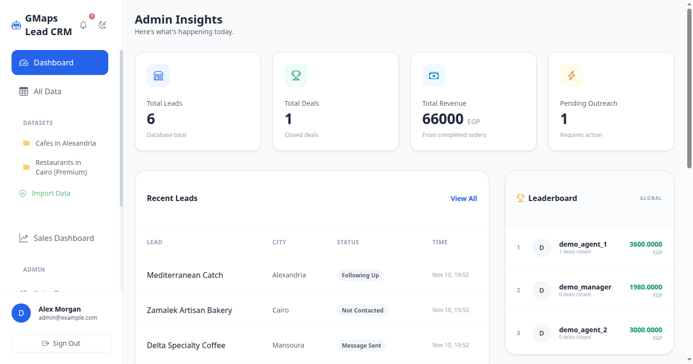
    </td>
    <td width="50%">
      <h4 align="center">Data Explorer & Smart Filters</h4>
      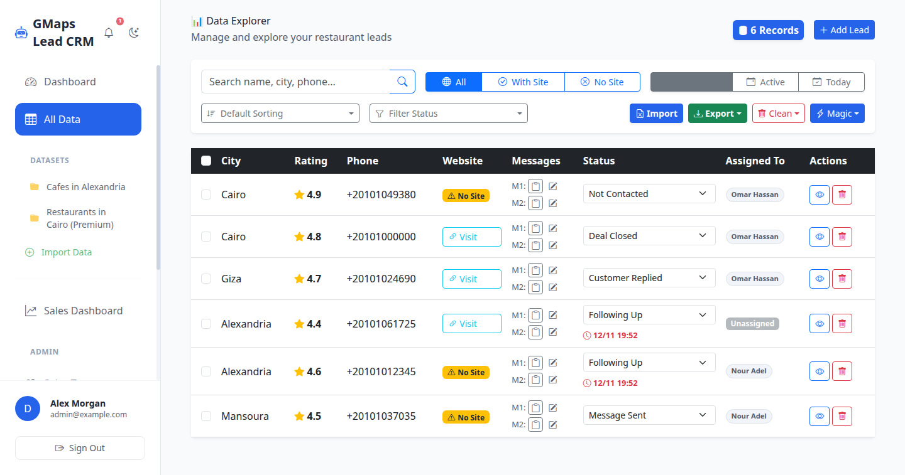
    </td>
  </tr>
  <tr>
    <td width="50%">
      <h4 align="center">Scraper Control Center & Live Console</h4>
      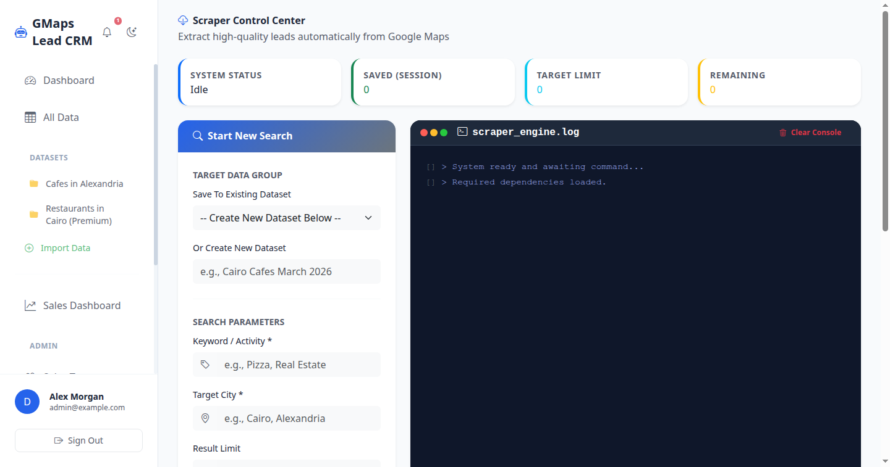
    </td>
    <td width="50%">
      <h4 align="center">Lead Dossier & Team Notes</h4>
      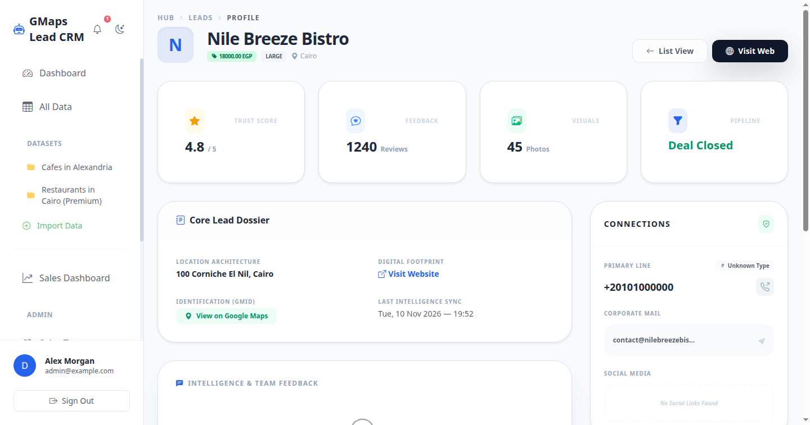
    </td>
  </tr>
  <tr>
    <td width="50%">
      <h4 align="center">Sales Team Hierarchy & Commissions</h4>
      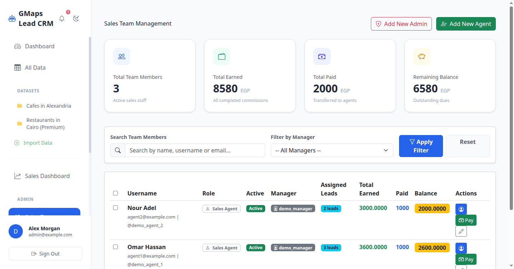
    </td>
    <td width="50%">
      <h4 align="center">Successful Sales & Net Revenue</h4>
      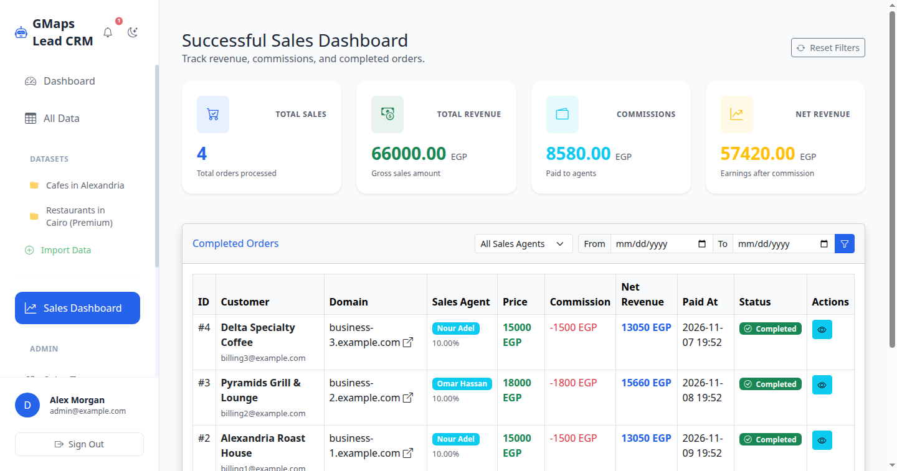
    </td>
  </tr>
  <tr>
    <td width="50%">
      <h4 align="center">Pending Deal Approvals</h4>
      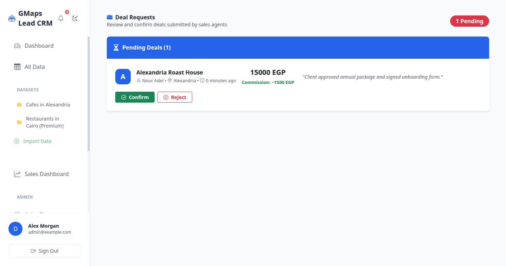
    </td>
    <td width="50%">
      <h4 align="center">Paymob Subscription Checkout</h4>
      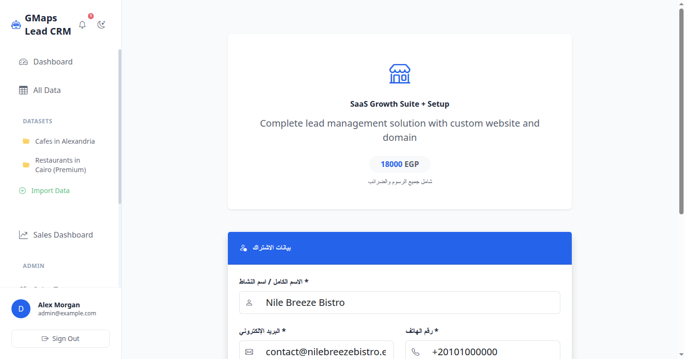
    </td>
  </tr>
  <tr>
    <td width="50%">
      <h4 align="center">White-Label & Theme Settings</h4>
      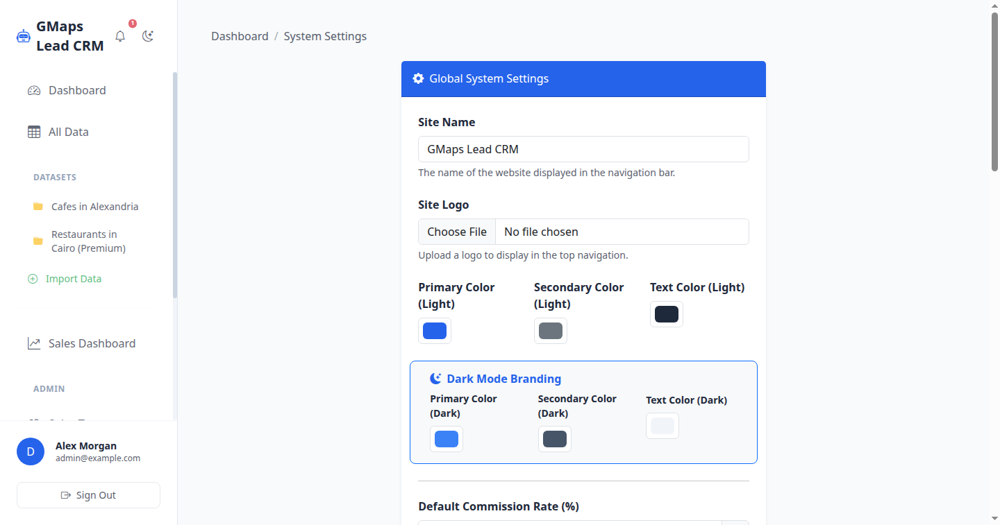
    </td>
    <td width="50%">
      <h4 align="center">Clean Authentication Portal</h4>
      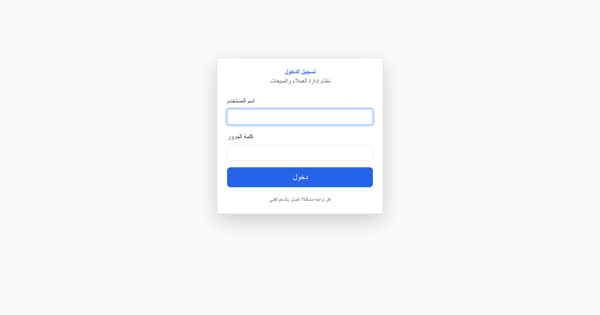
    </td>
  </tr>
</table>

### 🌙 Dark Mode Experience

<table>
  <tr>
    <td width="50%">
      <h4 align="center">Admin Insights Dashboard (Dark)</h4>
      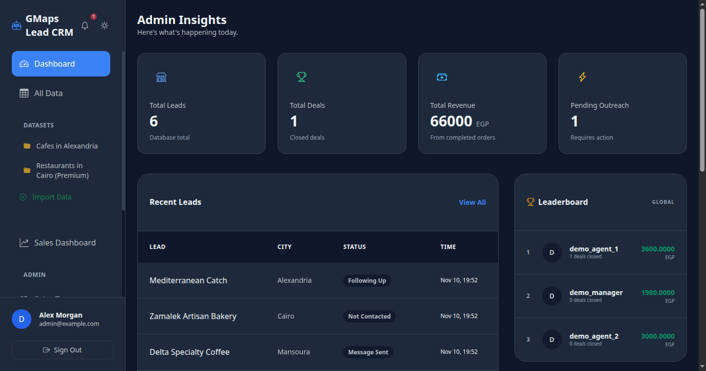
    </td>
    <td width="50%">
      <h4 align="center">Data Explorer (Dark)</h4>
      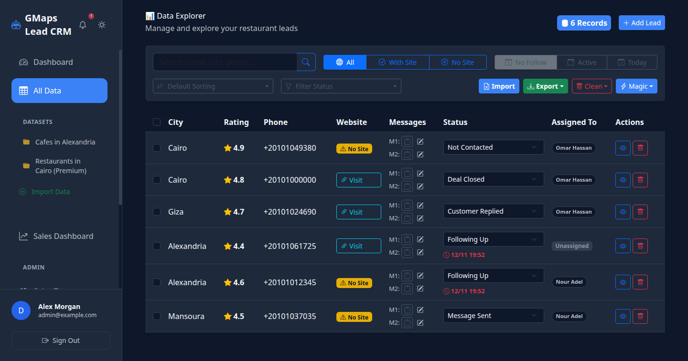
    </td>
  </tr>
  <tr>
    <td width="50%">
      <h4 align="center">Scraper Control Center (Dark)</h4>
      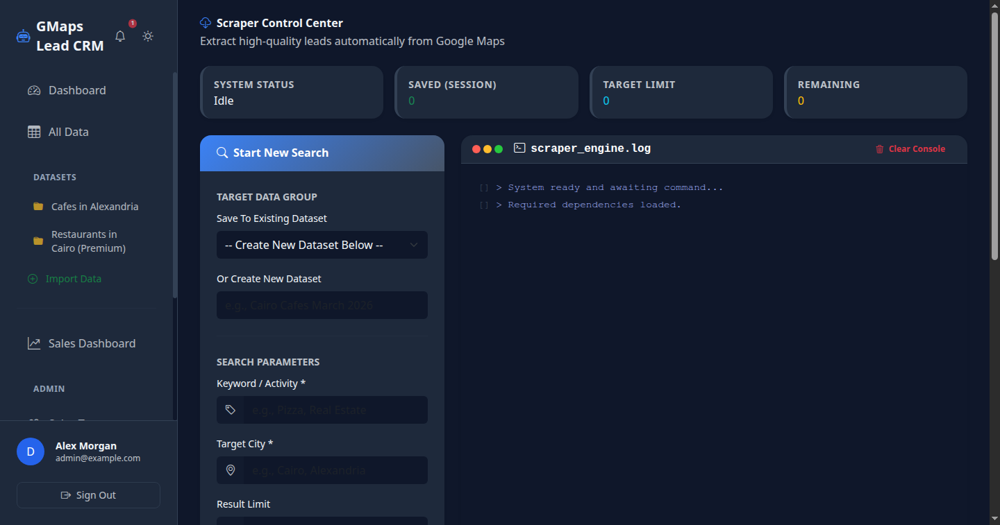
    </td>
    <td width="50%">
      <h4 align="center">Lead Dossier (Dark)</h4>
      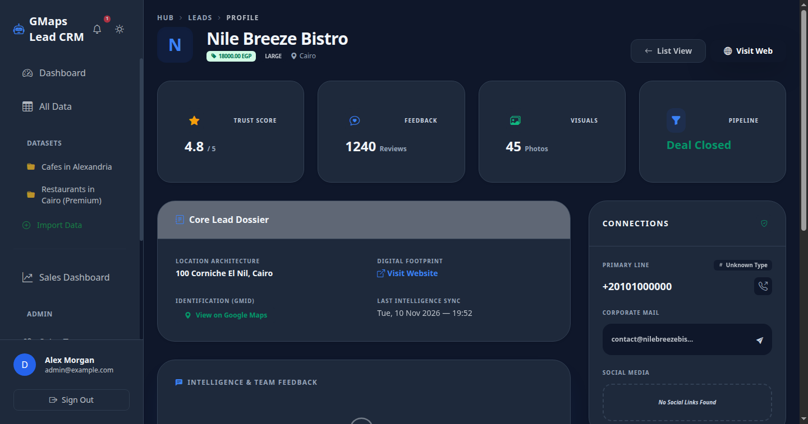
    </td>
  </tr>
</table>

---

## 🏗️ Architecture & Data Flow

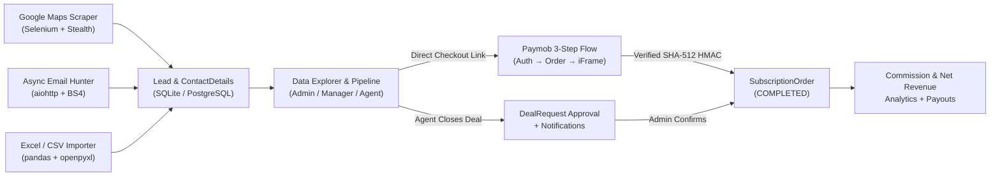

---

## 📁 Project Structure

```text
gmaps-lead-crm/
├── core/                         # Django project settings, root URLs, ASGI/WSGI
├── sales/                        # Core CRM, Scraper, Payments, Commissions & PWA
│   ├── logic/
│   │   └── email_hunter.py       # Concurrent aiohttp email extractor
│   ├── management/commands/
│   │   ├── scrape_gmaps.py       # Google Maps Selenium-Stealth scraper
│   │   ├── enrich_leads.py       # Batch async email enrichment command
│   │   ├── seed_db.py            # Demo database seeder
│   │   ├── setup_roles.py        # Group & permission initializer
│   │   └── verify_selectors.py   # Google Maps selector diagnostics
│   ├── static/                   # PWA manifest, Service Worker, JS/CSS assets
│   ├── templates/                # Tailwind + Bootstrap 5 + HTMX templates
│   ├── import_views.py           # Excel/CSV upload & field mapping views
│   ├── middleware.py             # Agent activity & online status tracking
│   ├── models.py                 # Lead, Dataset, DealRequest, Orders, Settings
│   ├── payment_views.py          # Paymob checkout, callback, receipt guards
│   ├── paymob_utils.py           # Paymob REST client & HMAC SHA-512 verifier
│   ├── sales_dashboard_views.py  # Completed sales & net revenue analytics
│   ├── sales_views.py            # Agent profiles, transfers, commissions
│   └── views.py                  # Dashboard, Data Explorer, Scraper & Deals UI
├── notifications/                # Real-time user notification API & inbox
├── docs/
│   ├── PAYMOB_SETUP.md           # Webhook & ngrok setup guide
│   └── screenshots/              # UI showcase images
├── .github/workflows/ci.yml      # GitHub Actions CI (checks + tests)
├── .env.example                  # Environment variable template
├── requirements.txt              # Python dependencies
└── manage.py
```

---

## 🚀 Quick Start

### 1. Clone & Create Virtual Environment
```bash
git clone https://github.com/mohamedharf/-gmaps-lead-crm.git gmaps-lead-crm
cd gmaps-lead-crm

python3 -m venv venv
source venv/bin/activate   # On Windows: venv\Scripts\activate
pip install -r requirements.txt
```

### 2. Configure Environment Variables
```bash
cp .env.example .env
```
> Paymob variables in `.env` are optional for running the CRM, Lead Scraper, and local demo. See [docs/PAYMOB_SETUP.md](docs/PAYMOB_SETUP.md) to connect live or sandbox Paymob payments.

### 3. Initialize Database & Demo Data
```bash
python manage.py migrate
python manage.py seed_db
```

### 4. Run the Development Server
```bash
python manage.py runserver
```
Open **`http://127.0.0.1:8000`** and sign in with the seeded demo accounts:

| Role | Username | Password |
| :--- | :--- | :--- |
| **Admin (Staff / Superuser)** | `demo_admin` | `demo1234!` |
| **Team Lead (Manager)** | `demo_manager` | `demo1234!` |
| **Sales Agent** | `demo_agent_1` | `demo1234!` |

---

## ⚙️ Management Commands

```bash
# Scrape Google Maps leads into a specific dataset (use --limit 0 for infinite scroll)
python manage.py scrape_gmaps "Restaurants" "Cairo" --limit 50 --dataset_id 1

# Run concurrent email extraction for scraped leads that have websites
python manage.py enrich_leads --dataset 1 --limit 100

# Create default Django permission groups (Admins, Sales)
python manage.py setup_roles

# Populate sample demo records and users
python manage.py seed_db
```

> **Note:** Running `scrape_gmaps` requires Google Chrome / Chromium installed locally; `webdriver-manager` resolves the matching driver automatically.

---

## 🔐 Environment Variables

| Variable | Default | Description |
| :--- | :--- | :--- |
| `DEBUG` | `True` | Django debug flag (`False` in production) |
| `SECRET_KEY` | Dev fallback | Django cryptographic signing key |
| `ALLOWED_HOSTS` | `localhost,127.0.0.1` | Comma-separated allowed hostnames |
| `SITE_URL` | `http://localhost:8000` | Public base URL for payment callbacks |
| `PAYMOB_API_KEY` | `""` | Paymob merchant API key |
| `PAYMOB_SECRET_KEY` | `""` | Paymob secret key |
| `PAYMOB_PUBLIC_KEY` | `""` | Paymob public key |
| `PAYMOB_HMAC_SECRET` | `""` | Paymob SHA-512 webhook HMAC secret |
| `PAYMOB_INTEGRATION_ID` | `0` | Paymob card integration ID |
| `PAYMOB_IFRAME_ID` | `0` | Paymob hosted checkout iFrame ID |
| `PAYMOB_BASE_URL` | `https://accept.paymob.com/api` | Paymob API endpoint |

---

## 🧪 Running Tests & CI

The test suite covers RBAC permissions, Deal Request approvals, tiered commission & net revenue calculations, timing-safe Paymob HMAC validation, payment receipt IDOR protection, and notification API scoping:

```bash
python manage.py check
python manage.py makemigrations --check --dry-run
python manage.py test sales notifications -v 2
```

---

## 📄 License

Distributed under the MIT License. See [LICENSE](LICENSE) for full details.
